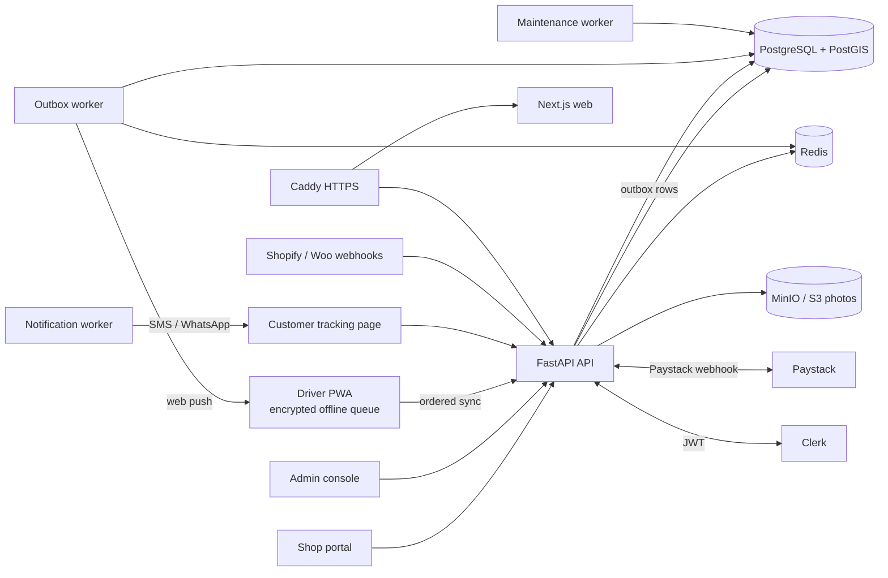

# Project: RouteBridge (Product Requirements Document)

Version 2.0, 21 October 2026. Replaces the original brief in `project description.md` as the description of what the
product is and does. The brief stays as the record of the original vision, market evidence and expansion path; this
document records what was built, what changed and why, and what is left before launch.

Status key used below: **Built** (in code and covered by tests), **Built, unproven** (in code, not yet tried with real
vendors, devices or money), **Gap** (not built).

## Purpose and Users

### Problem
Nigerian shops, pharmacies, restaurants and courier companies lose margin on same-city delivery because:
1. Orders arrive through WhatsApp, Instagram, calls and spreadsheets, with no single record.
2. Addresses are landmark-based and ambiguous ("opposite the blue church").
3. Dispatch is coordinated by phone and chat, so nobody knows which rider holds which parcel.
4. Fleets mix staff and contracted riders who are hard to control.
5. Proof of delivery is weak: a rider can claim a delivery that did not happen.
6. Cash on delivery (COD) leaks, and reconciling it per shop is manual.
7. Mobile data is unreliable, so apps that need constant connectivity fail mid-route.

### Product
RouteBridge is a multi-tenant delivery operating system. A delivery company (a **workspace**) runs its shops, riders,
dispatch, proof of delivery and COD settlement in one place. It is software for the delivery business, not a consumer
marketplace, and it does not own vehicles or hold customer funds.

### Users and roles (as built)
| User | Role key | Surface | What they do |
|---|---|---|---|
| Platform staff (RouteBridge) | `platformadmin` table + `ROUTEBRIDGE_PLATFORM_ADMIN_SUBJECTS` | Platform console | Create and suspend workspaces, set a workspace's plan, view the cross-company Activity feed. Sees counts and ownership, never a company's orders |
| Workspace owner = Admin | `tenant_owner` (one per workspace) | Console | Adds shops and Drivers, assigns orders, handles exceptions, reconciliation, claims, reports, settings |
| Shop (merchant) | `merchant_user` | Shop portal (`/portal/*`) | Registers itself, places orders, follows them, sees statements, raises claims, pays for its plan |
| Driver (rider; "Dispatcher" in code) | `driver` | Driver PWA (`/driver`) | Receives jobs, moves them through states, captures proof and cash, works offline |
| Customer | none (token link) | Tracking page | Sees the rider and ETA, receives the delivery code, can correct the location |

Older roles (`tenant_admin`, `dispatcher`, `operations_manager`, `finance`, partner, read-only) stay valid for existing
logins but cannot be assigned (`ASSIGNABLE_ROLES` in `models/access.py`). This is a deliberate simplification from the
brief: one Admin plus Drivers fits the size of the first customers.

### Success metrics
Each metric is computed by `GET /tenants/{t}/reports/summary?days=7|30|90` unless noted.
| Metric | Field | Pilot target (assumption, confirm) |
|---|---|---|
| On-time rate (delivered inside the window) | `on_time_rate` | >= 85% |
| First-attempt success | `first_attempt_success_rate` | >= 90% |
| COD variance left open | `cod.open_variance` | 0 at end of each settlement period |
| Deliveries completed without a verified code (with `REQUIRE_DELIVERY_CODE=true`) | count of delivered jobs with `code_verified=false` | 0 |
| Driver sync lag (event occurred to server receipt) | `MobileSyncEvent` timestamps, Prometheus | p95 < 10 min in pilot zones |
| Shops paying after trial | `merchantplan` rows on a paid plan / shops past trial | Unknown: set after pricing is final |

## Scope

### In scope (v1, as built)
**1. Workspaces, access and audit.** Built.
- Multi-tenant data: every table carries `tenant_id`; `tenant_member` refuses `driver` and `merchant_user`; shop staff only reach `/portal/*`, scoped to one merchant.
- Sign-in by Clerk; people and shops are added by Clerk user id only.
- Append-only `AuditEvent` and `PlatformAuditEvent`.
- Fixed session limits: 12 h max, 30 min idle (`components/session-guard.tsx`); 5 sign-in attempts per 15 min.

**2. Shop onboarding.** Built.
- Admin adds a shop by user id in Settings > Merchants (`POST /admin/tenants/{t}/merchants`), which creates its login.
- The shop completes its profile (`PUT /portal/profile`: company name, phone, address, bank account, service zone). It cannot create orders until `is_complete()` (422).
- Soft remove and restore (`DELETE .../merchants/{m}`, `POST .../restore`); refused with 409 while deliveries are on the way.

**3. Driver onboarding.** Built.
- The future Driver registers name, phone, photo and zones (`PUT /auth/me/rider-registration`).
- The Admin adds them by user id plus Staff or Contracted (`POST /tenants/{t}/members`, role `driver`); 422 if not registered.
- Zones are editable (`PUT /tenants/{t}/drivers/{id}/zones`); soft remove via `DELETE /tenants/{t}/drivers/{id}`.

**4. Order capture.** Built.
- Shops place orders in the portal (`/portal/orders`). Every order needs the customer's `service_zone_id`. Staff are refused by `no_staff_orders`.
- Machine intake: `POST /webhooks/orders/{tenant_id}` with Shopify, WooCommerce and generic mappers (`services/connectors.py`), plus idempotency records (`IdempotencyRecord`). Built, unproven with a live store.

**5. Nigerian location capture.** Built.
- `Stop` holds `address_text`, `landmark`, `delivery_notes`, `latitude`/`longitude`, `location_confidence`, `recipient_available`.
- Orders carry a `location_score` (0 to 100); low scores raise a `low_location_confidence` exception.
- Corrections by driver or customer are stored as `StopCorrection` (`POST /delivery-jobs/{id}/location-corrections`, `POST /public/tracking/{token}/correction`) and never overwrite the original.

**6. Dispatch.** Built.
- Dispatch board with manual assignment (`POST /delivery-jobs/{id}/assignments`), zone/window batches (`GET /dispatch/batches`, `POST /dispatch/batches/assign`) and optional automatic assignment per workspace (`PATCH /dispatch/settings`, `services/dispatch.py`).
- Auto-assignment never picks a busy or offline driver, and only matches zones.
- Zone rule everywhere: a job with no zone, or a driver with no zones, matches; otherwise the job's zone must be one of the driver's (409 on manual assignment).

**7. Driver execution.** Built.
- States: `pending > assigned > accepted > en_route > arrived > delivered | failed_attempt`, then `failed_attempt > rescheduled | returned`, with `cancelled` from any open state (`ALLOWED_TRANSITIONS`, `routes/operations.py:46`).
- Offline PWA: events are queued in IndexedDB, encrypted with a non-extractable AES-GCM device key (`lib/driver/store.ts`), and synced in order (`POST /driver/.../sync`).
- Navigation handoff (`lib/driver/navigate.ts`), call button, failed-attempt reason codes, and the shop's contact card (never bank details).

**8. Proof and fraud control.** Built.
- With `REQUIRE_DELIVERY_CODE=true` (compose default), a job reaches `delivered` only after the server verifies the customer's code. The code is hashed, expiring and attempt-limited; a photo or signature alone gets 409.
- The rider never sees the code. Wrong guesses are logged as `delivery.code_wrong` without the guess.
- Photo and signature go to S3/MinIO; evidence is readable by staff and the owning shop (`GET .../orders/{id}/evidence`).

**9. Customer visibility.** Built (SMS and WhatsApp unproven).
- Public tracking page by token (`GET /public/tracking/{token}`, `no-store`) shows the rider only while `en_route`/`arrived` and the last ping is < 15 min old.
- It shows the delivery code while it is valid.
- SMS and WhatsApp share of the link (`tracking-share`) and status texts go through the outbox and notification workers.

**10. Live status for staff and shops.** Built.
- Console uses a live event stream with a 20 s fallback poll; the shop portal polls every 10 s with toasts.
- Driver web push on assignment (VAPID).

**11. Money.** Built.
- COD capture (`POST /delivery-jobs/{id}/payments`).
- Reconciliation, including bank-statement import and resolve (`/reconciliation/*`).
- Rate cards with `cod_fee`.
- Shop statement = cash collected - delivery fees + approved claims (`GET .../merchants/{m}/statement[.csv]`).
- Payout export (`GET /payouts/export`).
- Claims: `open > investigating > approved | rejected`, then `approved > paid`; a reject reason is shown to the shop, and `internal_note` is staff only.

**12. Shop subscriptions.** Built, unproven with real money.
- Each shop has a plan (7-day trial, Basic, Standard, Pro; placeholder prices in `config/plans.py` `SHOP_PLANS`) and pays by Paystack from its portal.
- When the plan has ended or the month's orders are used up, `POST /portal/orders` returns 402. This is only enforced while `SHOP_BILLING_ENFORCED` is on and a Paystack key is set.
- Running deliveries are never blocked.

**13. Reports and exceptions.** Built.
- `GET /reports/summary` (7/30/90 days) and `GET /exceptions`. Exception kinds: `no_delivery_job`, `delivery_failed`, `late`, `unassigned_soon`, `low_location_confidence`, `cod_variance`.

**14. Privacy.** Built; legal review pending.
- Consent records, customer export and erase (`/customers/{id}/export|erase|consent`), retention worker.
- Bank data kept in a separate `merchantprofile` table.

### Out of scope (v1)
- A native Android app (the PWA covers offline use).
- Intercity line-haul, warehousing and multi-stop route optimisation beyond batching.
- Holding or moving money: statements and claims record what is owed; payouts are an export, not a transfer.
- Masked calling and chat (the brief listed it; the build uses a direct call handoff).
- Partner-courier API (third-party fleets), ERP and accounting connectors.
- Countries other than Nigeria; local-language UI.
- Kubernetes, Terraform and multi-region deployment (removed on purpose).

### Changes from the original brief and why
| Brief said | Built | Reason |
|---|---|---|
| TypeScript/Go backend | Python FastAPI + SQLModel | Faster delivery by a small team; typed models double as API schemas |
| Kotlin/React Native driver app, SQLite/Room | PWA with an encrypted IndexedDB queue | Install by link, no store review, works on cheap Android phones; same offline guarantees |
| Many operator roles | One Admin (owner) plus Drivers | First customers are small companies; fewer roles means fewer access mistakes |
| Staff and shops both create orders | Only shops create orders | The shop owns its orders, which makes the claims and statements clean |
| Admin sets up zones | Shops pick or add zones at registration | Zones come from where customers actually are |
| Company pays per plan | Each shop pays its own plan; the company plan is set by platform staff | Revenue follows the party that gets the value |
| Managed Kubernetes in-region | Docker Compose on one host (currently this PC via Tailscale Funnel) | No server or domain yet; Compose is enough for the pilot |

## Architecture

- **API** (`backend/apps/api/src/routebridge`): `routes/` handle HTTP and role checks, `services/` hold the logic, and `models/` hold the tables.
- **Events:** state changes write an `OutboxEvent` in the same transaction. The outbox worker publishes them (live stream, push), and the notification worker sends messages with retries. This guarantees no lost events and no events for rolled-back changes.
- **Web** (`frontend/routebridge/apps/web`): one Next.js app serves the console, portal, tracking page and driver PWA. Console pages all re-export `app/page.tsx`, which picks the view from the URL.

## Tech Stack
| Choice | Reason |
|---|---|
| FastAPI, Python 3.11 | Quick to build, request validation, OpenAPI docs |
| SQLModel + Alembic | One class per table and schema; versioned, idempotent migrations (`tools/migrate`) |
| PostgreSQL 16 + PostGIS | Transactions, plus spatial queries (nearby drivers) |
| Redis 7 | Locks, rate limits, live stream, worker queues |
| MinIO (S3 API) | Photos and signatures outside the database; portable to any S3 |
| Clerk | Hosted sign-in and MFA; no passwords stored by RouteBridge |
| Next.js 14, React 18, TypeScript | One app for all four surfaces; type checks before release |
| Leaflet + OSM/MapTiler/Mapbox | Maps with a switchable provider (`lib/map-source.ts`) |
| PWA + Web Push (VAPID, pywebpush) | Offline driver app and alerts without an app store |
| Paystack | The main Nigerian card and transfer gateway |
| SMS gateway (Termii-style JSON or Twilio) | Customers rely on SMS; provider is pluggable |
| Docker Compose + Caddy | One-command stack with automatic HTTPS |
| Prometheus, Alertmanager, Grafana | Metrics and alerts (`monitoring` profile) |

## Data Model
Tenancy: every business row has `tenant_id`, and queries filter on it. Shop-scoped reads also filter on `merchant_id`.

| Area | Tables | Key relationships |
|---|---|---|
| Access | `Tenant`, `User`, `TenantMembership`, `PlatformAdmin` | Membership links a user to a tenant with a role; `driver_id` ties a Driver login to a `Driver` |
| Shops | `Merchant`, `MerchantProfile`, `MerchantPlan` | Profile holds contact, bank and `service_zone_id`; one plan per shop |
| Geography | `Country`, `OperatingArea`, `TenantArea`, `ServiceZone`, `DriverZone` | Zones belong to a tenant; drivers to zones |
| Orders | `Customer`, `Order`, `DeliveryJob`, `Stop`, `JobPlan`, `StopCorrection` | Order 1:1 job; job 1:n stops; plan holds window and zone |
| Execution | `Driver`, `DriverAssignment`, `DeliveryAttempt`, `ProofOfDelivery`, `DeliveryOtp`, `TrackingToken`, `MobileSyncEvent` | Assignment history is kept (`unassigned_at`) |
| Money | `RateCard`, `PaymentRecord`, `ReconciliationItem`, `Claim`, `ClaimMessage`, `BillingPayment` | Payments per job; claims per order and shop |
| Messaging | `Notification`, `NotificationDelivery`, `PushSubscription`, `OutboxEvent` | |
| Governance | `AuditEvent`, `PlatformAuditEvent`, `ConsentRecord`, `IdempotencyRecord`, `WebhookReceipt` | Audit is append-only |

## API Surface
All endpoints are under `/api/v1`. Full list at `/docs`; the `/platform` routes are hidden from it.
- **Auth and self:** `/auth/me`, `/auth/me/tenants`, `/auth/me/rider-registration`.
- **Admin:**
  - Workspace: `/admin/tenants/{t}/merchants` (+ `removed-merchants`, `restore`), `/tenants/{t}/members`, `/tenants/{t}/drivers`, `/tenants/{t}/drivers/{id}/zones`, `/tenants/{t}/workspace`.
  - Orders and dispatch: `/tenants/{t}/orders`, `/tenants/{t}/delivery-jobs/{id}/assignments|auto-assign|transitions|plan|proof|payments|otp`, `/tenants/{t}/dispatch/batches|settings|auto-assign`.
  - Money and reports: `/tenants/{t}/reconciliation`, `/tenants/{t}/payouts/export`, `/tenants/{t}/merchants/{m}/statement`, `/tenants/{t}/reports/summary`, `/tenants/{t}/exceptions`, claims.
- **Portal (shop):** `/tenants/{t}/portal/orders`, `/profile`, `/zones`, `/statement`, `/billing`, `/checkout`, `/verify`, and order evidence and tracking-share.
- **Driver:** `/driver/tenants/{t}/me/token`, `/jobs`, `/sync`, `/jobs/{id}/uploads|otp|call`, push subscribe.
- **Public:** `/public/tracking/{token}` (+ `/correction`, `/consent`).
- **Webhooks:** `/webhooks/paystack` (registered before the generic route), `/webhooks/orders/{tenant_id}`, `/webhooks/{provider}`.
- **Platform:** `/platform/tenants`, `/platform/tenants/{t}/plan`, `/platform/audit`, `/platform/admins`.
- **System:** `/health`, `/ready`, `/metrics`.

## Milestones
Milestones 1 to 4 are done. The remaining work is launch work, ordered so each step can ship alone. Items come from
`docs/launch-checklist.md` unless marked new.

**M1 to M4 (done):** core orders and dispatch; offline driver app and proof; money (COD, statements, claims, shop plans);
Docker stack, backups, monitoring. Done condition was met: backend suite green (143 passed, 1 skipped at last record),
`deploy/backup-restore-test.sh` PASS, `db_selfcheck` PASS, HTTPS via Caddy PASS.

**M5: Secure the keys (blocker).**
- Roll the Clerk production secret, the Twilio token and the Clerk webhook secret that were exposed in chat.
- Done when: the old keys are revoked in each dashboard and the production check reports no secret problems.

**M6: A real server and domain (blocker).**
- Buy a domain; add DNS for `app.`, `api.`, `files.` and the Clerk CNAMEs.
- Deploy with `docker compose --profile https up -d --build` and switch to the production Clerk instance.
- Done when: sign-in works on the domain over HTTPS, the production check returns `[]`, and backups run every 6 h.

**M7: Real messaging (blocker for customers).**
- Register an SMS sender ID (Twilio upgraded or Termii) and set `SMS_SENDER_ID`.
- Done when: a test order sends a real tracking SMS and a real delivery code to a Nigerian number, recorded as delivered in `NotificationDelivery`.

**M8: Field pilot.**
- One workspace, 2 or 3 shops, 3 to 5 Drivers in one Lagos zone for 2 weeks.
- Test push on real phones, offline sync in poor coverage, and the code check with real customers.
- Done when: at least 100 delivered jobs, zero jobs delivered without a verified code, and reports show on-time and first-attempt rates.

**M9: Real money.**
- Set Paystack live keys, register the webhook, set final prices in `SHOP_PLANS`, and make a small real payment.
- Done when: a shop pays, `settle()` marks it paid once, and the 402 gate lifts.

**M10: Compliance and hardening.**
- NDPC registration, legal review of the privacy drafts, an external penetration test, and a load test at peak hour (the current setup is one API process).
- Done when: each has a written result and the blocking findings are fixed.

**Later (new, not scheduled):**
- Platform-console button for setting plans.
- Customer push after the tracking page is closed.
- Masked calling.
- Local languages.
- Native Android app if PWA limits show up in the pilot.

## Risks
| Risk | Mitigation (built or planned) |
|---|---|
| Ambiguous addresses and failed attempts | Landmark, notes, pin, confidence score, corrections without overwrite, reason codes, exceptions list |
| Poor connectivity and battery | Encrypted offline queue with ordered sync; strict state machine rejects bad order; sync-lag metric |
| COD fraud and leakage | Server-verified delivery code, attempt limits, reconciliation with statement import, variance exceptions |
| A single PC as server (power, internet, sleep) | M6 moves to a real server; until then `deploy/windows/*` scripts and off-machine backups |
| Exposed keys | M5 rotates them; `.env*` never committed |
| SMS not live, so customers never see codes outside the page | M7; until then the code shows on the tracking page and as a staff card (`OTP_DELIVERY=dashboard`) |
| Unknown capacity | M10 load test before onboarding more than the pilot |
| Regulatory exposure (payments, transport, data) | No funds held; Paystack as the licensed partner; NDPC and legal review in M10 |
| Vendor lock-in (maps, SMS, storage) | Adapters: `MAP_PROVIDER`, `SMS_AUTH_STYLE`, S3 API |

## Testing and Observability
- **Backend tests:** pytest in `backend/tests` against a scratch SQLite database (`ROUTEBRIDGE_DATABASE_URL=sqlite:///scratch_test.db`). Never point it at the real database.
- **Web checks:** `npx tsc --noEmit`, `npx next lint`, `npx vitest run`. A UI change also needs a screen check or a screenshot.
- **Proof scripts:** `deploy/backup-restore-test.sh` and `routebridge.tools.db_selfcheck`, both on throw-away databases.
- **Observability:** structured logs, `/metrics` for Prometheus, Alertmanager to `ALERT_WEBHOOK_URL`, and Grafana dashboards. Alerts to configure in M6: API error rate, outbox backlog, sync lag, failed notifications, backup age.
- **Not yet tested:** a real alert to an inbox, push on a real phone, Paystack live, Mapbox routing, and load.

## Deployment
- **Today:** this PC runs the stack. `web-demo` on port 3100 is published at https://neche.taile59d7a.ts.net with the Clerk development keys; SMS is in log mode.
- **Target:** one Linux server via `deploy/setup-server.sh` and `docs/deploy-without-a-domain.md`, then a domain (M6).
- **Secrets:** `.env.production` on the server only; `ENVIRONMENT=production` refuses unsafe settings.
- **Optional profiles:** never mark an optional profile's variable `:?required`.
- **Scaling assumption:** one API process plus three workers handles the pilot. Scale by adding API replicas behind Caddy after the M10 load test.

## Open Questions and Assumptions
1. **Pilot targets** (85% on-time, 90% first attempt, 2 weeks, 100 jobs) are assumptions. Confirm or replace.
2. **Shop plan prices** are placeholders. Who sets the final prices, and when?
3. **Shopify/WooCommerce webhook intake** exists in code but bypasses the portal. Should it stay enabled for shops, or be limited to platform-approved workspaces? Unknown how it interacts with `no_staff_orders` and shop billing gates; verify before the pilot.
4. **CSV import** (`/orders/import-csv`) is refused for staff. Is a shop-side CSV import wanted? Assumed: not in v1.
5. **Third-party fleets** (partner couriers) were in the brief but are out of v1. Confirm.
6. **`project description.md`** is kept unchanged as the original brief. Replace it with this document if you prefer one source.
